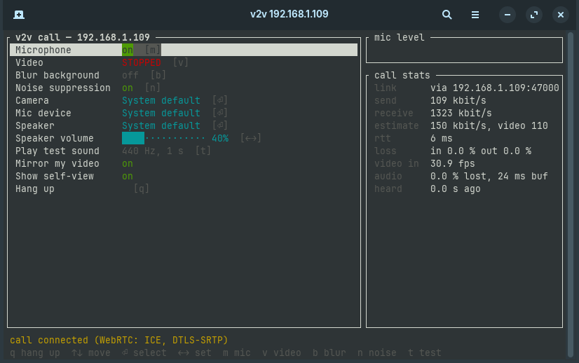
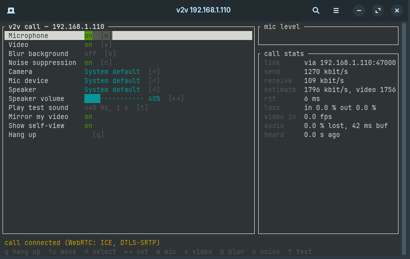

# v2v

Peer-to-peer video calls from the terminal.

```sh
cargo install --path . && cargo install tplay
```

`tplay` is only needed for `--tplay`, which also needs `ffprobe` from your ffmpeg package (`apt install ffmpeg`).

On one machine:

```sh
v2v 192.168.1.109
```



And on the other:

```sh
v2v 192.168.1.110
```



The call connects once both sides are running. A window shows the other side's video, and the terminal
becomes the call menu.

## Usage

| Command | |
| --- | --- |
| `v2v <ip>` | video call: each side runs `v2v` with the other's IP, and the call connects when both are running |
| `v2v` | answer the first caller instead (only needed if NAT rewrites the caller's address) |
| `v2v --audio [<ip>]` | audio only, with a spectrum of the other side's voice in the terminal |
| `v2v --tplay [<ip>]` | video as ASCII art in the terminal via [tplay](https://github.com/maxcurzi/tplay) (Linux only) |
| `v2v config` | the same menu without calling, with a camera preview, to test devices |
| `v2v -h` | help, including the exact command the other side should run for each of your addresses |

Menu keys: `m` mute, `v` video, `b` background blur, `n` noise suppression, `t` test tone,
arrows/Enter for devices and volume, `q` hang up. Settings are saved to `~/.config/v2v/config`.

## How it works

WebRTC via [str0m](https://github.com/algesten/str0m): H.264 video (openh264) and Opus audio. Bitrate follows a bandwidth
estimate, lost packets are retransmitted, and media is encrypted with DTLS-SRTP. There's no server: both sides use
**UDP port 47000** and exchange the session setup in-band, so that port must be reachable (LAN, VPN such as
WireGuard, or a port forward). Signalling is not authenticated.

Background blur uses MediaPipe selfie segmentation run with [tract](https://github.com/sonos/tract). Noise
suppression uses RNNoise ([nnnoiseless](https://github.com/jneem/nnnoiseless)).

Linux build deps: `libpipewire-0.3-dev`, `libasound2-dev`, `clang`/`libclang-dev`, X11 dev libs.
Windows and macOS need a C/C++ compiler for the bundled codecs. Cross-compiling from Linux works with
[zig](https://ziglang.org) 0.17 and [cargo-zigbuild](https://github.com/rust-cross/cargo-zigbuild) from git
(0.23.4 drops the `-exported_symbols_list` operand; zig 0.15's linker crashes on the macOS link):

```sh
rustup target add x86_64-pc-windows-gnu aarch64-apple-darwin
cargo zigbuild --target x86_64-pc-windows-gnu
# -fcommon: minifb defines g_metal_device in two Objective-C files, which upstream clang rejects
SDKROOT=/path/to/MacOSX.sdk CFLAGS_aarch64_apple_darwin=-fcommon cargo zigbuild --target aarch64-apple-darwin
```

## License

MIT, see [LICENSE](LICENSE). `assets/selfie_segmenter_landscape.onnx` is MediaPipe selfie_segmenter_landscape
© Google, [Apache License 2.0](https://www.apache.org/licenses/LICENSE-2.0), converted from TFLite to ONNX.
